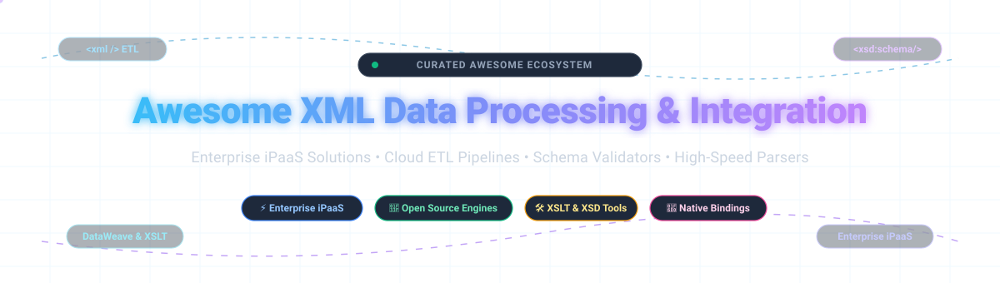

<div align="center">

<a href="https://github.com/ishandutta2007/Awesome-Awesome-Awesome"></a><a href="https://discord.gg/jc4xtF58Ve"></a>
[](http://creativecommons.org/publicdomain/zero/1.0/)
[](http://makeapullrequest.com)
[](https://github.com/ishandutta2007/Awesome-XML-Data-Processing-Integration/stargazers)
[](https://github.com/ishandutta2007/Awesome-XML-Data-Processing-Integration)
<a href="https://github.com/ishnndutta2007"></a>

<br/>



# 🌟 Awesome XML Data Processing & Integration 🚀

**A curated index of premier XML data processing, transformation, parsing, schema validation, and enterprise integration (iPaaS & ETL) platforms.**

*Comprehensive benchmarks covering hosted SaaS solutions, cloud data pipelines, zero-allocation serialization libraries, and battle-tested open-source frameworks.*

</div>

---

## 🧭 Table of Contents

- [📈 Sector Overview & Market Dynamics](#-sector-overview--market-dynamics)
- [🏢 SaaS & Hosted Commercial Platforms](#-saas--hosted-commercial-platforms)
- [💻 Open-Source Software & Frameworks](#-open-source-software--frameworks)
- [📊 Feature Comparison at a Glance](#-feature-comparison-at-a-glance)
- [🎯 SEO & Developer Key Terms](#-seo--developer-key-terms)
- [💖 Support](#-support)
- [🌟 Star History](#-star-history)
- [🤝 Contributing](#-contributing)
- [📄 License](#-license)

---

## 📈 Sector Overview & Market Dynamics

The global data integration and cloud ETL/iPaaS sector is valued at approximately **$14.5 Billion in 2024** and is projected to expand to over **$32 Billion by 2030**, advancing at a robust Compound Annual Growth Rate (CAGR) of ~13.5%. The market exhibits **moderate fragmentation**, featuring multi-billion-dollar enterprise hyperscalers alongside specialized niche vendors providing high-performance XML/EDI parsing, automated schema binding, and API-led orchestration engines.

---

## 🏢 SaaS & Hosted Commercial Platforms

Below is a detailed benchmark of commercial XML data processing, iPaaS, and transformation platforms, sorted in descending order by **Company Size (Revenue / Valuation)**.

| Platform | Company Size (Valuation / Revenue) 🌐 | Starting Price 💵 | Free Tier Limits / Free Trial ⏱️ | XML & Integration Focus 🔍 |
| :--- | :--- | :--- | :--- | :--- |
| **[Zoho DataBridge](https://www.zoho.com/analytics/)** | **~$12.5B Valuation** (~$1.5B Revenue) | **$25/mo** (Basic Plan, billed annually) | **Free Forever Plan:** 2 users, 5 workspaces, up to 10,000 rows storage | Low-code/no-code automated pipelines connecting on-premises XML files and databases to Zoho Analytics |
| **[Informatica Cloud Data Integration](https://www.informatica.com/products/cloud-data-integration.html)** | **~$7.9B Market Cap** (~$1.67B Revenue) | **Pay-as-you-go metering** (or ~$90-$100/IPU/mo via cloud marketplaces) | **Free Forever Tier (CDI-Free):** Up to 20 million rows or 10 compute hours/month; plus a 30-day enterprise evaluation trial | Enterprise-grade IDMC platform providing advanced ETL/ELT mapping, complex XML hierarchy parsing, and metadata governance |
| **[MuleSoft Anypoint Platform](https://www.mulesoft.com/)** | **$6.5B Acquisition** (Salesforce unit, >$1B+ ARR) | **$2,000/mo** ($24,000/yr starting package; $50k/yr pre-commit minimum) | **30-Day Free Trial:** Full platform sandbox access; metrics wiped and production disabled after 30 days | Industry-standard API-led connectivity with DataWeave language for deep XML, JSON, and CSV structural transformations |
| **[Workato](https://www.workato.com/)** | **$5.7B Valuation** (~$150M ARR) | **$75/mo** (Pro Tier base tier) | **Free Plan:** 50,000 credits one-time for workflow testing and initial automation builds | Visual enterprise recipe automation with native XML parsing, automated webhook dispatch, and API transformation |
| **[Boomi](https://boomi.com/)** | **$4.0B Acquisition** (~$500M Revenue) | **$99/mo** (Pay-As-You-Go self-service + ~$0.05 per processed Boomi Message) | **30-Day Free Trial:** Full access to low-code visual workflow designer, basic API management, and XML mapping connectors | Cloud-native iPaaS with visual data mapper, EDI/B2B integration, and high-throughput XML payload processing |
| **[Talend Cloud Data Integration](https://www.qlik.com/us/products/talend)** | **$2.4B Acquisition** (Qlik / Thoma Bravo, ~$350M Revenue) | **$1,170/user/month** (Starter tier benchmark; custom capacity contracts) | **14-Day Free Trial:** Full access to cloud ETL/ELT studio and pipeline orchestrations with no credit card required | Comprehensive pipeline platform with complex XML/hierarchical schemas, data cleansing, and streaming ETL |
| **[SnapLogic](https://www.snaplogic.com/)** | **$1.0B Valuation** (~$120M-$364M Revenue) | **$9,995/yr** (~$833/mo base entry contract; custom annual enterprise terms) | **Guided Sales PoC only:** No public self-service trial; existing subscribers receive 30-day Snap catalog trials | AI-assisted integration (Iris AI) with pre-built Snaps for XML serialization, JSON transformations, and big data endpoints |
| **[Celigo](https://www.celigo.com/)** | **~$600M Valuation** (~$95M ARR) | **$500/mo** (Standard tier baseline, billed annually) | **30-Day Free Trial:** Unlimited flows and endpoints; downgrades to **Free Forever Plan** (capped at 2 apps & 1 active flow) | iPaaS optimized for e-commerce and SaaS ecosystems with bi-directional XML/EDI payload mapping and error recovery |
| **[Altova XMLSpy Cloud](https://www.altova.com/xmlspy-xml-editor)** | **~$50M Valuation** (~$7.7M Annual Revenue) | **$679 one-time** (Professional Edition license; Enterprise $1,099) | **30-Day Free Trial:** Full enterprise desktop/cloud suite with XSLT debugging, XQuery, and XSD editing tools | Gold-standard professional XML/JSON IDE featuring visual XSD schema generation, XPath 3.1 analysis, and XQuery profiling |
| **[Liquid Studio](https://www.liquid-technologies.com/liquid-studio)** | **~$20M Valuation** (~$3M Annual Revenue) | **$149 one-time** (Liquid Studio standard license) | **15-Day Free Trial:** Full advanced toolkit; automatically reverts to **Free Community Edition** after 15 days | Dedicated XML/XSD development toolkit offering graphical schema design, Web Service testing, and data-binding code generators |

---

## 💻 Open-Source Software & Frameworks

Explore actively maintained open-source XML data processing engines, enterprise integration routers, and native binding libraries. Sorted in descending order by **GitHub_Stars** ⭐.

### 1. [Airbyte](https://github.com/airbytehq/airbyte) [](https://github.com/airbytehq/airbyte/stargazers)
* **Stack:** Java / Python / Kotlin | **License:** MIT / Elastic License  
* **Capabilities:** Leading open-source data integration platform with hundreds of pre-built connectors. Extracts and replicates XML, JSON, and unstructured data streams from APIs, file systems, and enterprise data warehouses.  
* **Best For:** Modern ELT data engineering pipelines requiring scalable XML feed ingestion into Snowflake, BigQuery, or Databricks.

### 2. [Apache Camel](https://github.com/apache/camel) [](https://github.com/apache/camel/stargazers)
* **Stack:** Java | **License:** Apache 2.0  
* **Capabilities:** Battle-tested Enterprise Integration Patterns (EIP) framework in production since 2007. Features **350+ native connectors** and supports route definitions in Java, YAML, or XML. Camel K provides Kubernetes-native deployments and Camel Karavan delivers low-code visual route orchestration.  
* **Best For:** Java and enterprise teams seeking an Apache-governed runtime for complex routing and XML message transformation.

### 3. [node-xml2js](https://github.com/Leonidas-from-XIV/node-xml2js) [](https://github.com/Leonidas-from-XIV/node-xml2js/stargazers)
* **Stack:** JavaScript / Node.js | **License:** MIT  
* **Capabilities:** Simple, bidirectional XML-to-JavaScript object converter. Built upon `sax-js`, making it an industry staple for converting XML payloads in REST/SOAP microservices.  
* **Best For:** Node.js backend developers requiring lightweight, zero-dependency XML-to-JSON parsing.

### 4. [pugixml](https://github.com/zeux/pugixml) [](https://github.com/zeux/pugixml/stargazers)
* **Stack:** C++ | **License:** MIT  
* **Capabilities:** Extremely fast, lightweight C++ XML processing library featuring a DOM-like interface with rich XPath 1.0 support. Renowned for its minimal memory footprint and blistering execution speed in high-throughput engines.  
* **Best For:** High-performance, latency-sensitive applications requiring embedded C/C++ XML parsing.

### 5. [fast-xml-parser](https://github.com/NaturalIntelligence/fast-xml-parser) [](https://github.com/NaturalIntelligence/fast-xml-parser/stargazers)
* **Stack:** JavaScript / TypeScript | **License:** MIT  
* **Capabilities:** High-speed XML parser and validator written in pure JavaScript without C/C++ native dependencies. Supports XML validation, XML-to-JSON transformation, JSON-to-XML serialization, and schema preservation.  
* **Best For:** High-volume Node.js microservices and client-side web apps needing fast XML translation.

### 6. [lxml](https://github.com/lxml/lxml) [](https://github.com/lxml/lxml/stargazers)
* **Stack:** Python / C (libxml2 & libxslt) | **License:** BSD  
* **Capabilities:** The most powerful, feature-complete XML and HTML processing library for Python. Combines libxml2 speed with a Pythonic ElementTree API. Full support for XPath 1.0, XSLT 1.0, XML Schema (XSD), and RELAX NG.  
* **Best For:** Python data scientists and backend engineers requiring robust XML validation and complex XSLT transforms.

### 7. [quick-xml](https://github.com/tafia/quick-xml) [](https://github.com/tafia/quick-xml/stargazers)
* **Stack:** Rust | **License:** MIT  
* **Capabilities:** High-performance pull-based XML parser and serializer in Rust. Provides zero-copy parsing, streaming reading and writing, and full `serde` integration for effortless struct mapping.  
* **Best For:** Rust developers seeking maximum memory efficiency and CPU throughput for multi-gigabyte XML datasets.

### 8. [BaseX](https://github.com/BaseXdb/basex) [](https://github.com/BaseXdb/basex/stargazers)
* **Stack:** Java | **License:** BSD 3-Clause  
* **Capabilities:** Robust, lightweight, high-performance XML database engine and XPath/XQuery 3.1 processor. Provides a complete client/server architecture for querying, indexing, and processing vast document collections.  
* **Best For:** Enterprises managing deep hierarchical XML documents requiring full-text search and XQuery analytics.

### 9. [Jackson Dataformat XML](https://github.com/FasterXML/jackson-dataformat-xml) [](https://github.com/FasterXML/jackson-dataformat-xml/stargazers)
* **Stack:** Java | **License:** Apache 2.0  
* **Capabilities:** Standard Jackson extension that enables reading and writing XML using Jackson data-binding annotations. Seamlessly converts XML directly into POJOs alongside JSON configurations.  
* **Best For:** Spring Boot and Java backend services wanting unified JSON/XML serialization pipelines.

### 10. [Cenit IO](https://github.com/cenit-io/cenit) [](https://github.com/cenit-io/cenit/stargazers)
* **Stack:** Ruby (Rails) / MongoDB / RabbitMQ | **License:** MIT  
* **Capabilities:** Open-source Integration Platform as a Service (iPaaS) for orchestrating data flows, triggering webhooks, and managing enterprise pipelines. Transforms across **JSON, XML, EDIFACT, X12, and UBL**.  
* **Best For:** Organizations seeking a self-hosted open-source iPaaS capable of bridging legacy EDI and modern XML data.

### 11. [eXist-db](https://github.com/eXist-db/exist) [](https://github.com/eXist-db/exist/stargazers)
* **Stack:** Java | **License:** LGPL-2.1  
* **Capabilities:** Native open-source XML database solution built completely around XML technologies. Supports XQuery 3.1, XPath, XSLT, and native schema indexing for structured and semi-structured documents.  
* **Best For:** Digital humanities, document management systems, and XML-first archival stores.

### 12. [Smooks](https://github.com/smooks/smooks) [](https://github.com/smooks/smooks/stargazers)
* **Stack:** Java | **License:** Apache 2.0 / LGPL  
* **Capabilities:** Extensible Java-based data processing engine for XML, EDI, CSV, and JSON. Utilizes an event-driven stream pipeline architecture to transform, enrich, and filter complex records without loading whole DOMs into memory.  
* **Best For:** High-volume Java event streaming and legacy EDI-to-XML data enrichment pipelines.

### 13. [QXmlEdit](https://github.com/lbellonda/qxmledit) [](https://github.com/lbellonda/qxmledit/stargazers)
* **Stack:** C++ / Qt | **License:** LGPL v2  
* **Capabilities:** Graphical cross-platform XML editor and visual XSD viewer. Features rare visual modes, large-file splitting (multi-gigabyte chunks), Base64 encoding tools, and XML diff comparisons.  
* **Best For:** Desktop engineers and system administrators needing a graphical editor to visualize schemas and split oversized XML logs.

### 14. [PolyXML](https://github.com/nth-bailey/PolyXML) [](https://github.com/nth-bailey/PolyXML/stargazers)
* **Stack:** Rust (core) / Python / Go / Java / Node.js | **License:** MIT  
* **Capabilities:** Polyglot native XML data-binding engine designed for zero DOM allocation parsing. Uses `quick-xml` reader events and `iterparse` streaming for O(1) constant-memory processing of massive files.  
* **Best For:** Multi-language microservice environments needing high-performance XML streaming.

### 15. [RAXB](https://github.com/hd-gmbh-dev/raxb) [](https://github.com/hd-gmbh-dev/raxb/stargazers)
* **Stack:** Rust | **License:** MIT  
* **Capabilities:** The Rust Architecture for XML Binding automates bidirectional marshalling between XML documents and type-safe Rust structures.  
* **Best For:** Rust developers building reliable, strongly typed XML serialization layers.

### 16. [xMLTree](https://github.com/ehitimum/xMLTree) [](https://github.com/ehitimum/xMLTree/stargazers)
* **Stack:** Python | **License:** MIT  
* **Capabilities:** Lightweight XML tree editor with an integrated Excel column extractor. Allows fast tree traversal, attribute searching, and bulk XML updates.  
* **Best For:** Quick tree-view XML inspections and extracting tabular data from spreadsheets.

### 17. [XML Copy Editor](https://github.com/Distrotech/xmlcopyeditor) [](https://github.com/Distrotech/xmlcopyeditor/stargazers)
* **Stack:** C++ / wxWidgets | **License:** GPL v2  
* **Capabilities:** Fast, validating XML desktop editor focused on DTD, XML Schema, and RELAX NG validation. Includes tag locking, pretty printing, and Microsoft Word document conversion.  
* **Best For:** Technical writers and document architects working with DITA, DocBook, and schema-strict XML.

---

## 📊 Feature Comparison at a Glance

| Solution | Model | Pricing / License | Star Rating / Scale | Deployment | Primary Strength |
| :--- | :--- | :--- | :--- | :--- | :--- |
| **Zoho DataBridge** | Commercial | $25/mo | Enterprise | Cloud SaaS | No-code database-to-cloud automated data pipelines |
| **Informatica IDMC** | Commercial | PayGo / IPU | Enterprise | Hybrid Cloud | Large-scale enterprise data governance and ETL |
| **MuleSoft Anypoint** | Commercial | $2,000/mo | Enterprise | Hybrid Cloud | DataWeave transformations and API-led connectivity |
| **Workato** | Commercial | $75/mo | Enterprise | Cloud SaaS | Low-code workflow automation recipes and webhook sync |
| **Boomi** | Commercial | $99/mo | Enterprise | Cloud-Native | Visual EDI/XML data mapping with pay-as-you-go flexibility |
| **Talend Cloud** | Commercial | $1,170/seat/mo | Enterprise | Cloud / Hybrid | Scalable cloud data integration and streaming ETL |
| **SnapLogic** | Commercial | $9,995/yr | Enterprise | Cloud SaaS | AI-assisted pipeline generation and big data processing |
| **Celigo** | Commercial | $500/mo | Enterprise | Cloud SaaS | Pre-built e-commerce and NetSuite XML/EDI connectors |
| **Altova XMLSpy** | Commercial | $679 one-time | Enterprise | Windows / Cloud | Professional XSD, XQuery, and XSLT debugging studio |
| **Liquid Studio** | Commercial | $149 one-time | Mid-Market | Windows Desktop | XML schema modeling, data mapping, and web service testing |
| **Airbyte** | Open Source | MIT / Elastic | ⭐ 22.3k+ | Self-Hosted / Cloud | Hundreds of ELT connectors for bulk data replication |
| **Apache Camel** | Open Source | Apache 2.0 | ⭐ 6.3k+ | Self-Hosted (Java) | 350+ enterprise integration connectors and XML routes |
| **node-xml2js** | Open Source | MIT | ⭐ 4.9k+ | Node.js Runtime | Streamlined XML-to-JSON parsing in JavaScript |
| **pugixml** | Open Source | MIT | ⭐ 4.6k+ | Embedded C++ | Blazing-fast DOM parsing and XPath queries |
| **fast-xml-parser** | Open Source | MIT | ⭐ 3.1k+ | Node.js / Browser | Ultra-fast TypeScript/JS XML validation and conversion |
| **lxml** | Open Source | BSD | ⭐ 3.0k+ | Python Environment | Full libxml2/libxslt binding with Pythonic ElementTree API |
| **quick-xml** | Open Source | MIT | ⭐ 1.5k+ | Rust Crates | Zero-copy streaming pull parser with Serde serialization |
| **BaseX** | Open Source | BSD | ⭐ 760+ | Self-Hosted Server | Native XML database engine with full XQuery 3.1 support |
| **Jackson XML** | Open Source | Apache 2.0 | ⭐ 630+ | Java Runtime | POJO-to-XML serialization with Jackson dataformat |
| **Cenit IO** | Open Source | MIT | ⭐ 500+ | Self-Hosted / Docker | Full open-source iPaaS handling XML, JSON, and EDI |
| **eXist-db** | Open Source | LGPL-2.1 | ⭐ 470+ | Self-Hosted Server | Document-oriented native XML datastore with XQuery |
| **Smooks** | Open Source | Apache 2.0 | ⭐ 420+ | Java Runtime | Fine-grained event-driven data streaming pipelines |
| **QXmlEdit** | Open Source | LGPL v2 | ⭐ 180+ | Desktop (Qt) | Graphical XML/XSD visualization and big file splitter |
| **PolyXML** | Open Source | MIT | Niche Active | Polyglot (Rust) | Zero-alloc streaming reader across languages |
| **RAXB** | Open Source | MIT | Niche Active | Rust Library | Type-safe XML schema binding for Rust |
| **xMLTree** | Open Source | MIT | Niche Active | Desktop (Python) | Tree-view XML editor with Excel column extraction |
| **XML Copy Editor** | Open Source | GPL v2 | Niche Active | Desktop (wxWidgets) | Schema-validating editor for DITA, DocBook, and Word |

---

## 🎯 SEO & Developer Key Terms

`xml-data-processing` • `data-integration` • `ipaas-platforms` • `cloud-etl` • `xml-parser` • `xml-to-json` • `xsd-validation` • `xslt-transformation` • `xpath-query` • `dataweave` • `mulesoft-alternative` • `boomi-alternative` • `apache-camel` • `streaming-xml` • `zero-copy-parser` • `enterprise-integration-patterns`

---

## 💖 Support

Thank you for exploring this curated guide to XML data processing and integration platforms! If you find this repository helpful, please consider showing your support:

- ⭐ **Star** this repository to make it easier for other engineers and architects to find.
- 🍴 **Fork** it to keep a personal copy or contribute your own benchmarks.
- 📢 **Share** it with your developer community, colleagues, and friends.
- ☕ **Buy me a coffee:** If this resource saved you engineering hours, consider sponsoring or buying a coffee via the [Sponsor Dashboard](https://github.com/sponsors/ishandutta2007).

---

## 🌟 Star History

[](https://star-history.dera.page/#ishandutta2007/Awesome-XML-Data-Processing-Integration&type=date&legend=top-left)

---

## 🤝 Contributing

We warmly welcome additions, corrections, and tool suggestions! If you maintain or use a noteworthy XML Data Processing or Integration framework, please open a pull request following these guidelines:

1. **Verify Source:** Ensure open-source projects have active commits within the past 12 months.
2. **Include Links:** Add the project's repository link, technology stack, and primary standout feature.
3. **Keep Format:** Maintain table ordering, badge links, and markdown conventions.

```bash
# Fork & clone the repo
git clone https://github.com/ishandutta2007/Awesome-XML-Data-Processing-Integration.git
cd Awesome-XML-Data-Processing-Integration

# Create your branch
git checkout -b add/my-awesome-tool

# Commit and push
git commit -m "feat: add [Tool Name] to open-source directory"
git push origin add/my-awesome-tool
```

---

## 📄 License

[](http://creativecommons.org/publicdomain/zero/1.0/)

To the extent possible under law, the authors and contributors have waived all copyright and related or neighboring rights to this work under the **Creative Commons CC0 1.0 Universal Public Domain Dedication**.

---

<div align="center">
⭐ <b>Found this collection useful? Star this repository to help others discover it!</b> ⭐
</div>
